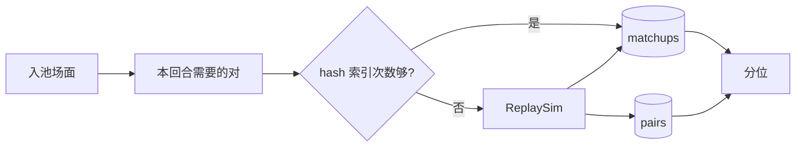

# 方案：两两阵容对战结果落盘

- **状态：** implemented
- **任务：** P3 战力引擎增量（所有者 2026-10-10 要求设计并直接落盘）
- **作者 / 日期：** agent / 2026-10-10
- **相关：** [P3-T1](P3-T1-strength-engine.md) §3.6、ADR-0011

## 1. 目标与非目标

**目标：** 同一 BB 版本的全部已结束对局放进一个参照池算分。任意两个入池场面之间的模拟结果只算一次，下次只补新对。

**非目标：** 不把 1.85 与 1.88.6 混桶。不改 `S` / 分位公式。不把 `cache.sqlite` 提交进 git（`data/` 已忽略）。

## 2. 依据

- 对战次数已按 `pairKey` 存在 `data/strength/cache.sqlite` 的 `pairs`（P3-T1 §3.6）。次数可合并，不存作废的比率。
- 2026-10-10 实测：只要有一个回合留一局后不足 \(G_\text{min}\)，打分会把 **整桶** 的 turn±1 都当成缺对去补跑（约 1.9 万对）。方案 §3.3 只要求给薄回合做 L1。

## 3. 方案

`pairs` 继续按模拟输入的 hash 存次数。新增 `matchups`：

| 列 | 含义 |
| --- | --- |
| `bbVersion`, `rowBoardId`, `colBoardId` | 主键。方向分开（A 打 B 与 B 打 A 是两行） |
| `pairKey` | 指向 `pairs` |
| `rowBoardHash`, `colBoardHash`, `shellHash` | 写入时的场面与规则壳 hash |
| `turnRow`, `turnCol` | 双方回合 |

流程：

1. 回填或增量时先读该版本的 hash 索引。
2. 索引里次数已够：写入或更新 `matchups`，不调用模拟器。
3. 不够：只把缺的对送进 ReplaySim，成功后同时写入 `pairs` 和 `matchups`。
4. 打分时，只有留一局后局数 < \(G_\text{min}\) 的回合才取 turn±1 的对手；局数够的回合只用同回合对。



## 4. 考虑过的替代方案

| 方案 | 为什么不选 |
| --- | --- |
| 另存一份 JSONL 矩阵 | 与 sqlite 双写，次数合并规则会分叉 |
| 继续只靠 `pairKey`、不记场面 Id | 能避免重跑，但看不出「哪两个阵容打过」；规划缺对时仍要逐对拼装 |
| 薄回合时整桶打开 turn±1 | 已发生：早回合被拖进跨回合重算 |

## 5. 验收方式

```powershell
python -m unittest discover -s tools/strength
```

- hash 索引命中时 `plan_jobs` 返回空任务，并写出 `matchups`。
- `slack_turns` 只含薄回合时，局数够的回合不会去要邻回合对手。
- 对 `1.88.6.0` 全量 `percentile` 后：`missingAfter=0`；再跑一次 `--dry-run` 回填，`pairsMissing=0`。

## 6. 风险与回退

场面内容变了而 `boardId` 不变时，`matchups` 会在下一次回填被新 hash 覆盖；旧 `pairs` 行留着，不参与新 key。删掉 `matchups` 表不影响 `pairs`，下次回填会按 hash 重新挂上。

## 7. 任务拆分

1. `matchups` 表、命中即登记、L1 只覆盖薄回合。
2. 把尚未入库的 1.88.6 已结束对局并进标准层，全池算分，缺对写入缓存。
